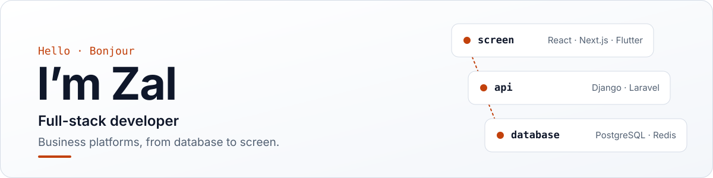

<picture>
  <source media="(prefers-color-scheme: dark)" srcset="assets/header-dark.svg">
  
</picture>

  
  
  

Get in touch.

 

## What I bring

- **Business platforms, from database to screen.** APIs, admin interfaces, authentication and roles, workflows and reporting. At CROUS-T I work on the finance, human resources and campus housing platforms.
- **Real-time features and background work.** WebSockets with Django Channels, job queues with Celery and Redis, and token-based APIs with Django Ninja and Laravel.
- **Web and mobile from one back end.** React and Next.js for the web, Flutter for mobile.
- **Shipping steadily.** Small, reviewable pull requests, each tied to a Jira ticket, so a team can follow, test and roll back every change.
- **Running what I build.** Linux, Docker, Nginx and PostgreSQL in production. At home, I self-host my own services.

## Beyond code

- **Clear writing.** Specs, architecture notes and API guides that record *why* a decision was made, not just what it was. In French and English.
- **Product thinking.** I start from the user's problem, write the spec first, and keep what the product promises in line with what it actually does.
- **Visual design.** Posters, flyers and brand material in Figma, Canva and Illustrator.

## Currently at CROUS-T

I’m part of the development team behind the internal platforms of a regional student-services agency: finance, human resources and campus housing. The back ends are Laravel APIs and the front ends are React with Vite.

## Stack

<table>
  <tr>
    <td><b>Back end</b></td>
    <td>
      
      
      
      
      
      
    </td>
  </tr>
  <tr>
    <td><b>Front end and mobile</b></td>
    <td>
      
      
      
      
      
      
      
    </td>
  </tr>
  <tr>
    <td><b>Data and infrastructure</b></td>
    <td>
      
      
      
      
      
      
      
      
      
      
      
    </td>
  </tr>
  <tr>
    <td><b>Also used</b></td>
    <td>NestJS, Svelte and SvelteKit, Tailwind CSS, Bootstrap, Ant Design, MySQL, MongoDB, SQLite, Supabase, Firebase, Kubernetes, Apache, GitLab, Netlify, Pandas, NumPy, PyTorch, LaTeX</td>
  </tr>
</table>

## Homelab

I self-host on my own NAS: **Immich** for photos, **Seafile** for files, and a **Plex** media library fed by the ***arr** stack, all reachable over **Tailscale**.

## GitHub stats

  <picture>
    <source media="(prefers-color-scheme: dark)" srcset="https://github-readme-stats-three-delta-98.vercel.app/api?username=zaldev&theme=github_dark&hide_border=true&include_all_commits=true&count_private=true&hide=stars,issues&hide_rank=true">
    
  </picture>
  <picture>
    <source media="(prefers-color-scheme: dark)" srcset="https://github-readme-stats-three-delta-98.vercel.app/api/top-langs/?username=zaldev&theme=github_dark&hide_border=true&include_all_commits=true&count_private=true&layout=compact">
    
  </picture>

